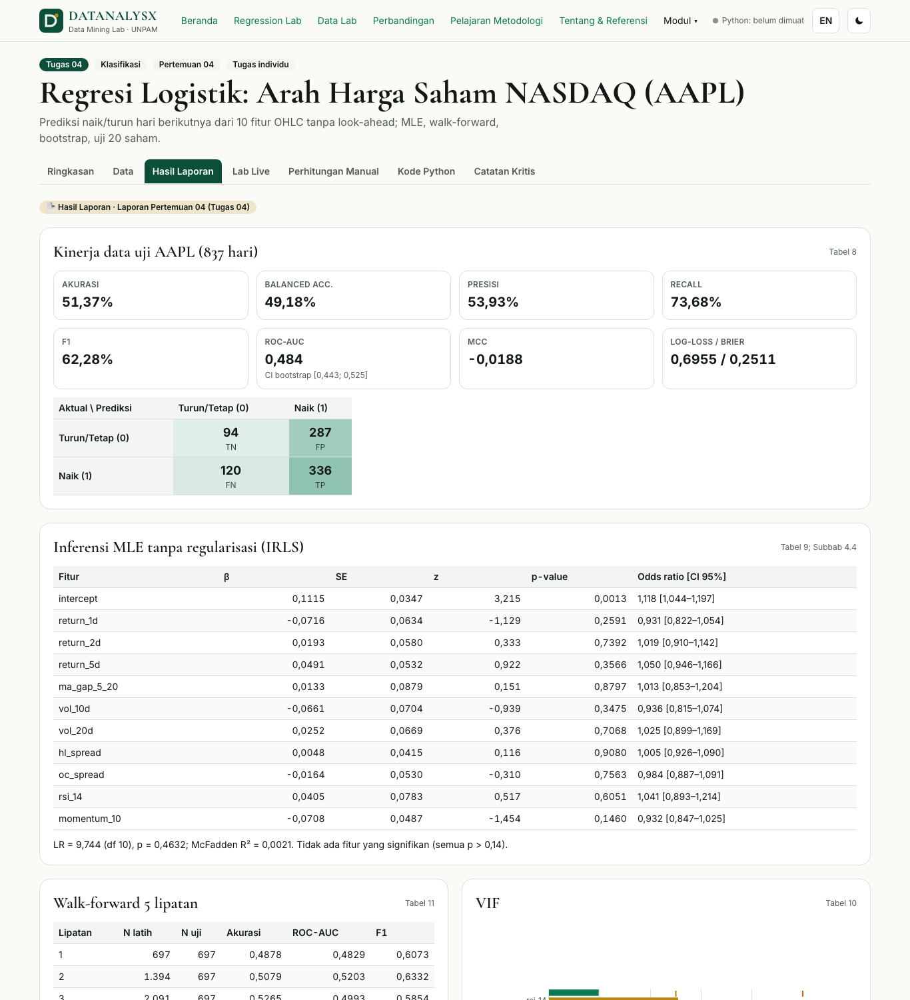
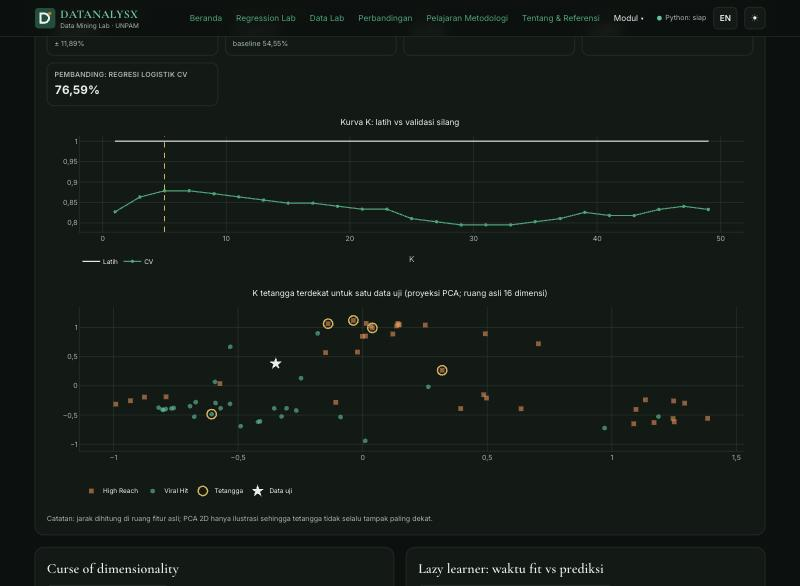
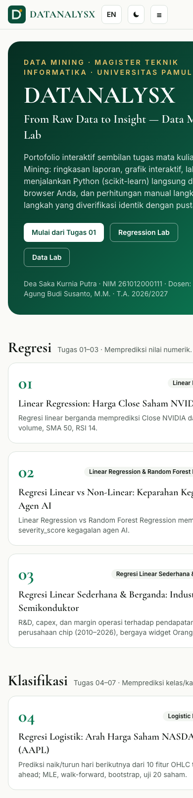

# DATANALYSX — From Raw Data to Insight · Data Mining Lab

Portofolio interaktif dan lab **Data Mining** (Tugas 01–09) — Magister Teknik Informatika, Universitas Pamulang.
Seluruh komputasi Python (numpy, pandas, scikit-learn, scipy) berjalan **di browser** lewat Pyodide; tidak ada backend, API key, ataupun pelacakan.

| | |
|---|---|
| **Pemilik** | Dea Saka Kurnia Putra — NIM 261012000111 — S2 TI Reg B 02 (01MKMM002) |
| **Mata kuliah** | Data Mining — Dosen: Dr. Ir. Agung Budi Susanto, M.M. — T.A. 2026/2027 |
| **Demo** | <!--URLS-->[GitHub Pages](https://dskputra.github.io/datanalysx/) · [Vercel](https://datanalysx.vercel.app) · [Netlify](https://datanalysx.netlify.app)<!--/URLS--> |


## Tautan

<!--LINKS-->
- Repositori: https://github.com/DSKPutra/datanalysx
- GitHub Pages: https://dskputra.github.io/datanalysx/ (dideploy otomatis oleh GitHub Actions dari `main`)
- Vercel: https://datanalysx.vercel.app
- Netlify: https://datanalysx.netlify.app (situs sudah dibuat; deploy menunggu kredit akun Netlify ditambahkan)
<!--/LINKS-->

## Sembilan modul

Setiap modul (`/tugas-01` … `/tugas-09`) memiliki tab **Ringkasan · Data · Hasil Laporan · Lab Live · Perhitungan Manual · Kode Python · Catatan Kritis**.
“Hasil Laporan” ditranskripsi dari laporan/`model_summary.json` (berkas JSON di `public/data/tugas-XX.json`, setiap angka diberi sumber tabel); “Hasil Live” dihitung ulang di browser — keduanya tidak pernah dicampur.

| Tugas | Kelompok | Algoritma | Dataset | Hasil utama (laporan) | Dataset contoh |
|---|---|---|---|---|---|
| 01 | Regresi | Linear Regression | NVIDIA Stock 1999–2026 | MAE 0,0047; R² 0,999994 (estimasi dalam-hari) + **Uji Realisme** lag/split waktu | ✅ CC0 |
| 02 | Regresi | Linear vs Random Forest | LLM Agent Failure Benchmark* | R² 0,139 vs 0,770 | ✅ Apache 2.0 |
| 03 | Regresi | OLS sederhana & berganda (widget ala Orange) | Semikonduktor 2010–2026 | R² 0,823 → 0,988 (log-log); hubungan definisional | ✅ CC0 |
| 04 | Klasifikasi | Regresi Logistik | NASDAQ OHLC (AAPL + 20 emiten) | AUC 0,484; lintas saham 0,5156 (p = 0,0075) | ⬆️ unggah (© pemilik) |
| 05 | Klasifikasi | Decision Tree | Trending Topics 2026 (sintetis) | 20% (metadata) vs 100% (kata judul); permutasi p = 0,970 | ✅ CC0 |
| 06 | Klasifikasi | Gaussian Naïve Bayes (kelompok 4) | Makro multi-aset Indonesia | 48,48% → 51,87% setelah winsorization | ✅ CC BY-SA 4.0 |
| 07 | Klasifikasi | KNN | Instagram Reels 2026 | CV 88,46%; uji 77,27% | ✅ CC0 |
| 08 | Clustering | K-Means | AAPL 2026 (semi-sintetis) | 3 rezim 41/52/23 hari; silhouette 0,210 | ✅ Apache 2.0 |
| 09 | Text Mining | Preprocessing, TF-IDF, InSet, MNB/LR/SVM/KNN, LDA/NMF | Komentar MBG | *laporan belum tersedia* | ⬆️ unggah |

\*Laporan Tugas 02 menamai datanya “AI Economy Pulse”; berkasnya identik dengan *LLM Agent Failure Analysis Benchmark Dataset* (lihat `public/data/samples/LICENSES.md`).

Halaman tambahan: **Regression Lab** (Tugas 01–03 gabungan + panel asumsi klasik), **Data Lab** (EDA, praproses before–after, leaderboard klasifikasi), **Perbandingan Algoritma**, **Pelajaran Metodologi**, **Tentang & Referensi** (daftar pustaka APA 7th disalin dari laporan).

| Laporan Tugas 04 | Lab KNN (mode gelap) | Mobile |
|---|---|---|
|  |  |  |

## Arsitektur

```
src/                     React 18 + Vite 5 + TypeScript + Tailwind + React Router
  lib/pyodide/           Web Worker Pyodide 0.29.5 (CDN jsDelivr) + klien RPC berantrean, dimuat lazy
  lib/manual/            Perhitungan manual TypeScript (OLS, sigmoid, entropy/IG, Gaussian NB, KNN, Lloyd, TF-IDF)
  pages/                 Tugas01–09, RegressionLab, DataLab, Compare, Lessons, About
python/dmx/              Modul Python yang dijalankan di browser (diringkas dari skrip tugas)
python/original/         Skrip asli tiap tugas (dari lampiran laporan / berkas .py)
python/tests/            pytest: reproduksi angka laporan + kesetaraan perhitungan manual
public/data/             tugas-XX.json (Hasil Laporan), references.json, samples/ (dataset berlisensi)
public/sw.js             Service worker: cache paket Pyodide dari CDN
docs/                    verifikasi-angka.md, screenshots, ringkasan proyek
```

* Pipeline scikit-learn memastikan scaler/encoder/TF-IDF di-fit hanya pada data latih; data saham memakai split berbasis waktu. Mode yang meniru laporan (mis. Tugas 01 split acak, Tugas 06 IQR seluruh periode) tetap tersedia dan diberi label.
* `random_state = 42` di semua modul. Versi pustaka uji = versi Pyodide (scikit-learn 1.7.0) — penting karena scikit-learn ≥ 1.8 tidak mereproduksi Tugas 01 (lihat `docs/verifikasi-angka.md`).
* Leksikon InSet & kamus slang Salsabila dkk. dimuat saat runtime dari GitHub aslinya (tidak diredistribusi); Sastrawi dipasang lewat micropip.

## Menjalankan lokal

```bash
npm ci
```

```bash
npm run dev
```

Uji & build:

```bash
npm run lint && npm run typecheck && npm test && npm run build
```

```bash
pip install -r requirements-test.txt && python -m pytest python/tests -q
```

Uji Tugas 04 di pytest memerlukan `.localdata/AAPL.csv` (dataset NASDAQ tidak diredistribusi) dan otomatis di-skip bila tidak ada.

## Kualitas

* **104 angka** Hasil Laporan dibandingkan dengan reproduksi → 101 cocok, 3 selisih terdokumentasi (`docs/verifikasi-angka.md`).
* **pytest 18** (reproduksi + kesetaraan manual < 10⁻⁸) · **Vitest 9** (implementasi manual TS vs fixture scikit-learn < 10⁻⁸).
* Lighthouse (build produksi, mobile simulasi): Accessibility 100, Performance 81–99.
* CI GitHub Actions: lint + typecheck + Vitest + build + pytest pada setiap push/PR; GitHub Pages dideploy dari `main`.

## Peringatan

Hasil bukan saran investasi. R² Tugas 01 bukan kemampuan peramalan; hubungan Tugas 03 definisional, bukan kausal; dataset AAPL 2026 dan Trending Topics sintetis; label sentimen otomatis ≠ ground truth; komentar YouTube ≠ opini publik Indonesia.

## Lisensi

Kode: MIT (lihat `LICENSE`). Dataset contoh mengikuti lisensinya masing-masing (`public/data/samples/LICENSES.md`).
