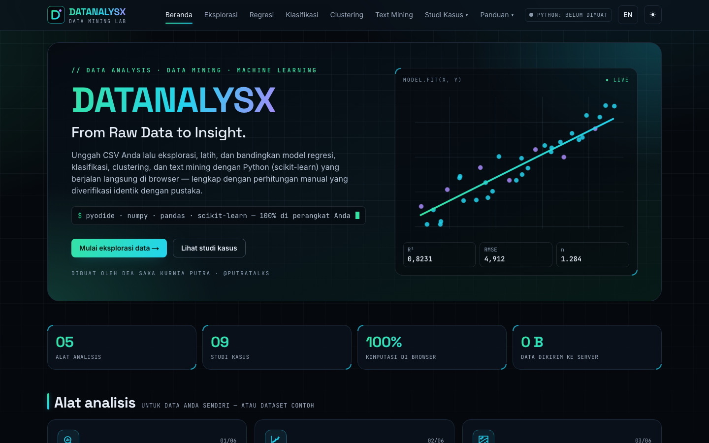
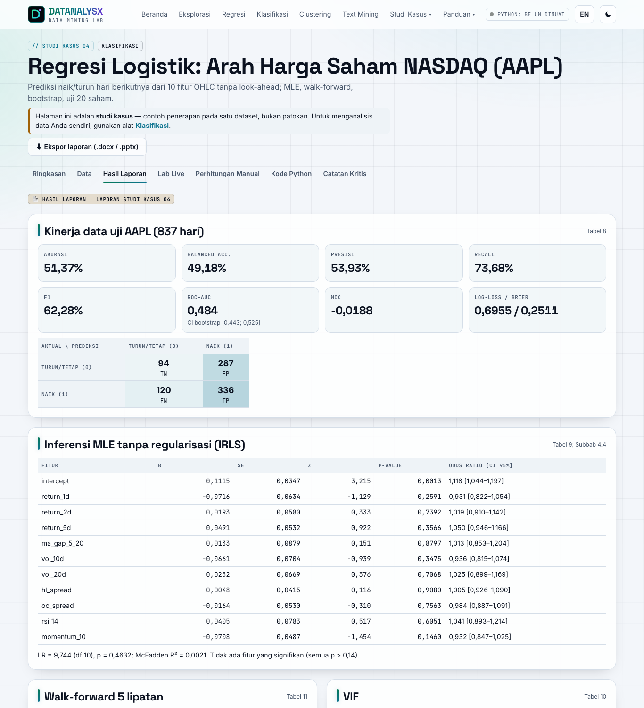
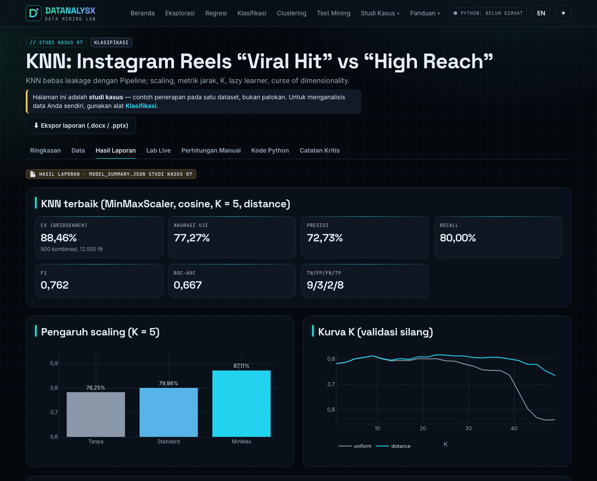
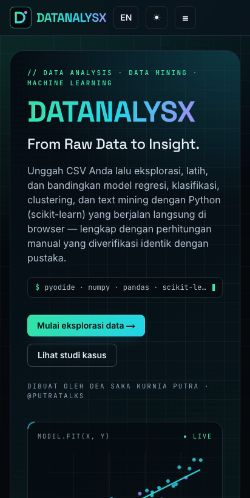

# DATANALYSX — From Raw Data to Insight · Data Mining Lab

Lab **analisis data & data mining** berbasis browser: unggah CSV Anda lalu lakukan eksplorasi, regresi, klasifikasi, clustering, dan text mining — lengkap dengan perhitungan manual langkah demi langkah yang diverifikasi identik dengan scikit-learn. Sembilan **studi kasus** disertakan sebagai contoh penerapan.
Seluruh komputasi Python (numpy, pandas, scikit-learn, scipy) berjalan **di browser** lewat Pyodide; tidak ada backend, API key, ataupun pelacakan.

| | |
|---|---|
| **Pembuat** | Dea Saka Kurnia Putra (@PUTRATALKS) |
| **Demo** | <!--URLS-->[GitHub Pages](https://dskputra.github.io/datanalysx/) · [Vercel](https://datanalysx.vercel.app) · [Netlify](https://datanalysx.netlify.app)<!--/URLS--> |



## Tautan

<!--LINKS-->
- Repositori: https://github.com/DSKPutra/datanalysx
- GitHub Pages: https://dskputra.github.io/datanalysx/ (dideploy otomatis oleh GitHub Actions dari `main`)
- Vercel: https://datanalysx.vercel.app
- Netlify: https://datanalysx.netlify.app (situs sudah dibuat; deploy menunggu kredit akun Netlify ditambahkan)
<!--/LINKS-->

## Alat analisis (fokus utama)

| Alat | Route | Isi |
|---|---|---|
| Eksplorasi & praproses | `/eksplorasi` | Profil kolom, missing, outlier, korelasi, praproses before–after |
| Regresi | `/regresi` | 7 model (Linear, log-log, Ridge, Lasso, Tree, Random Forest, kNN), split acak/berbasis waktu, uji asumsi klasik, regresi sederhana manual |
| Klasifikasi | `/klasifikasi` | Logistic Regression, Gaussian NB, KNN, Decision Tree, Random Forest; metrik, ROC, CV, leaderboard, perhitungan manual |
| Clustering | `/clustering` | K-Means: elbow/siluet/DBI, PCA, profil klaster, unduh CSV berlabel, animasi Lloyd, uji kestabilan |
| Text Mining | `/text-mining` | Preprocessing Bahasa Indonesia, TF-IDF manual, sentimen InSet, klasifikasi teks, LDA/NMF |

Setiap alat menerima CSV unggahan Anda atau dataset contoh dari studi kasus (`?sample=<kunci>`).

### Ekspor laporan (.docx) dan slide (.pptx)

Setiap alat dan studi kasus memiliki tombol **Ekspor laporan**. Isi **nama penyusun** (wajib, diingat di browser) dan judul, lalu unduh:

* **Laporan Word (.docx):** halaman sampul (judul, nama penyusun, tanggal, sumber & dataset), lalu judul bagian, tabel metrik, tabel hasil, catatan, dan grafik; header judul serta nomor halaman.
* **Presentasi PowerPoint (.pptx, 16:9):** slide judul, kartu metrik, tabel (dipecah 12 baris per slide), satu grafik per slide, slide teks, dan penutup.

Isinya adalah konten yang sedang tampil (tab aktif dan hasil yang sudah dihitung). Grafik Plotly dirender ulang berlatar putih agar terbaca saat dicetak. Berkas disusun di browser dengan [docx](https://docx.js.org) dan [PptxGenJS](https://gitbrent.github.io/PptxGenJS/) yang dimuat lazy — tidak ada data yang dikirim ke server.

## Sembilan studi kasus (contoh penerapan)

Setiap studi kasus (`/studi-kasus-01` … `/studi-kasus-09`) memiliki tab **Ringkasan · Data · Hasil Laporan · Lab Live · Perhitungan Manual · Kode Python · Catatan Kritis**.
“Hasil Laporan” ditranskripsi dari laporan/`model_summary.json` (berkas JSON di `public/data/studi-kasus-XX.json`, setiap angka diberi sumber tabel); “Hasil Live” dihitung ulang di browser — keduanya tidak pernah dicampur.

| No | Kelompok | Algoritma | Dataset | Hasil utama (laporan) | Dataset contoh |
|---|---|---|---|---|---|
| 01 | Regresi | Linear Regression | NVIDIA Stock 1999–2026 | MAE 0,0047; R² 0,999994 (estimasi dalam-hari) + **Uji Realisme** lag/split waktu | ✅ CC0 |
| 02 | Regresi | Linear vs Random Forest | LLM Agent Failure Benchmark* | R² 0,139 vs 0,770 | ✅ Apache 2.0 |
| 03 | Regresi | OLS sederhana & berganda (widget ala Orange) | Semikonduktor 2010–2026 | R² 0,823 → 0,988 (log-log); hubungan definisional | ✅ CC0 |
| 04 | Klasifikasi | Regresi Logistik | NASDAQ OHLC (AAPL + 20 emiten) | AUC 0,484; lintas saham 0,5156 (p = 0,0075) | ⬆️ unggah (© pemilik) |
| 05 | Klasifikasi | Decision Tree | Trending Topics 2026 (sintetis) | 20% (metadata) vs 100% (kata judul); permutasi p = 0,970 | ✅ CC0 |
| 06 | Klasifikasi | Gaussian Naïve Bayes | Makro multi-aset Indonesia | 48,48% → 51,87% setelah winsorization | ✅ CC BY-SA 4.0 |
| 07 | Klasifikasi | KNN | Instagram Reels 2026 | CV 88,46%; uji 77,27% | ✅ CC0 |
| 08 | Clustering | K-Means | AAPL 2026 (semi-sintetis) | 3 rezim 41/52/23 hari; silhouette 0,210 | ✅ Apache 2.0 |
| 09 | Text Mining | Preprocessing, TF-IDF, InSet, MNB/LR/SVM/KNN, LDA/NMF | Komentar MBG | *laporan belum tersedia* | ⬆️ unggah |

\*Laporan studi kasus 02 menamai datanya “AI Economy Pulse”; berkasnya identik dengan *LLM Agent Failure Analysis Benchmark Dataset* (lihat `public/data/samples/LICENSES.md`).

Halaman pendukung: **Perbandingan Algoritma**, **Pelajaran Metodologi**, **Tentang & Referensi** (daftar pustaka APA 7th dari laporan studi kasus). Route lama `/tugas-0X`, `/regression-lab`, dan `/data-lab` dialihkan otomatis.

| Studi Kasus 04 — Hasil Laporan | Studi Kasus 07 — Hasil Laporan | Mobile |
|---|---|---|
|  |  |  |

## Arsitektur

```
src/                     React 18 + Vite 5 + TypeScript + Tailwind + React Router
  lib/pyodide/           Web Worker Pyodide 0.29.5 (CDN jsDelivr) + klien RPC berantrean, dimuat lazy
  lib/export/            Ekspor laporan: pengumpul konten halaman → .docx (docx) / .pptx (PptxGenJS)
  lib/manual/            Perhitungan manual TypeScript (OLS, sigmoid, entropy/IG, Gaussian NB, KNN, Lloyd, TF-IDF)
  pages/tools/           Alat umum: Eksplorasi, Regresi, Klasifikasi, Clustering, Text Mining
  pages/                 StudiKasus01–09, Compare, Lessons, About
python/dmx/              Modul Python yang dijalankan di browser (alat umum: eda, datalab, classify, cluster; studi kasus: t01–t09)
python/original/         Skrip asli tiap studi kasus (dari lampiran laporan / berkas .py)
python/tests/            pytest: reproduksi angka laporan, kesetaraan perhitungan manual, alat umum
public/data/             studi-kasus-XX.json (Hasil Laporan), references.json, samples/ (dataset berlisensi)
public/sw.js             Service worker: cache paket Pyodide dari CDN
docs/                    verifikasi-angka.md, screenshots, ringkasan proyek
```

* Pipeline scikit-learn memastikan scaler/encoder/TF-IDF di-fit hanya pada data latih; data saham memakai split berbasis waktu. Mode yang meniru laporan (mis. studi kasus 01 split acak, studi kasus 06 IQR seluruh periode) tetap tersedia dan diberi label.
* `random_state = 42` di semua modul. Versi pustaka uji = versi Pyodide (scikit-learn 1.7.0) — penting karena scikit-learn ≥ 1.8 tidak mereproduksi studi kasus 01 (lihat `docs/verifikasi-angka.md`).
* Desain: tema gelap/terang bernuansa futuristik (grid latar, kartu kaca, aksen neon emerald → cyan, Space Grotesk + JetBrains Mono); animasi menghormati `prefers-reduced-motion`, kontras teks memenuhi WCAG AA di kedua tema.
* Leksikon InSet & kamus slang Salsabila dkk. dimuat saat runtime dari GitHub aslinya (tidak diredistribusi); Sastrawi dipasang lewat micropip.

## Menjalankan lokal

```bash
npm ci
```

```bash
npm run dev
```

Uji & build:

```bash
npm run lint && npm run typecheck && npm test && npm run build
```

```bash
pip install -r requirements-test.txt && python -m pytest python/tests -q
```

Uji studi kasus 04 di pytest memerlukan `.localdata/AAPL.csv` (dataset NASDAQ tidak diredistribusi) dan otomatis di-skip bila tidak ada.

## Kualitas

* **104 angka** Hasil Laporan dibandingkan dengan reproduksi → 101 cocok, 3 selisih terdokumentasi (`docs/verifikasi-angka.md`).
* **pytest 24** (reproduksi + kesetaraan manual < 10⁻⁸) · **Vitest 15** (implementasi manual TS vs fixture scikit-learn < 10⁻⁸; ekspor .docx/.pptx).
* Lighthouse (build produksi, mobile simulasi): Accessibility 100, Performance 81–99.
* CI GitHub Actions: lint + typecheck + Vitest + build + pytest pada setiap push/PR; GitHub Pages dideploy dari `main`.

## Peringatan

Hasil bukan saran investasi. R² studi kasus 01 bukan kemampuan peramalan; hubungan studi kasus 03 definisional, bukan kausal; dataset AAPL 2026 dan Trending Topics sintetis; label sentimen otomatis ≠ ground truth; komentar YouTube ≠ opini publik Indonesia.

## Lisensi

Kode: MIT (lihat `LICENSE`). Dataset contoh mengikuti lisensinya masing-masing (`public/data/samples/LICENSES.md`).
